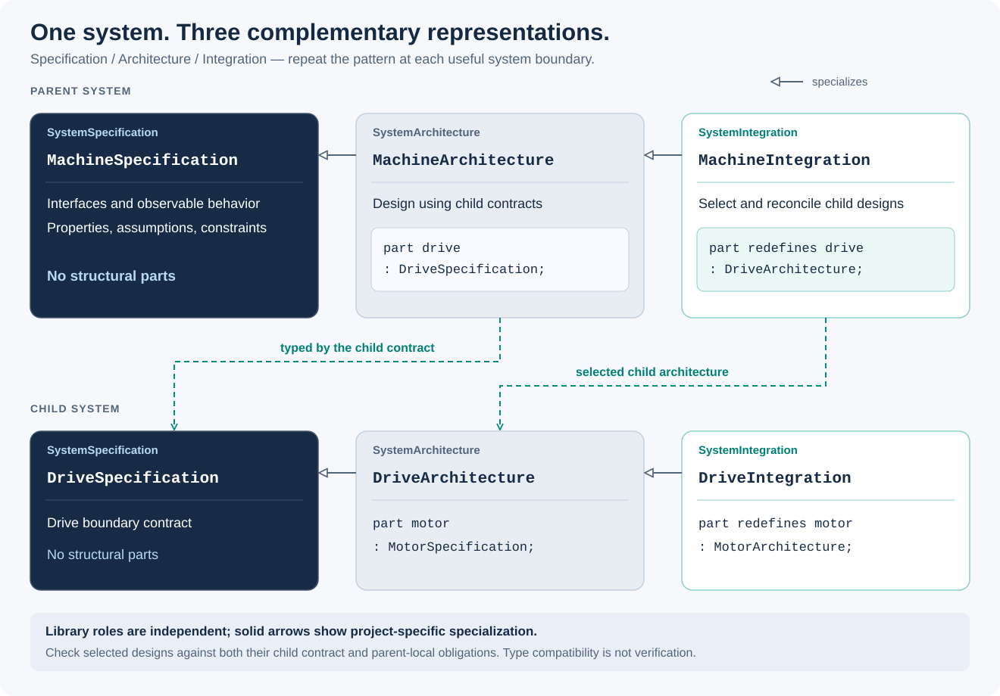

# Elan8 MBSE methodology

A small set of SysML v2 modeling conventions: system-owned packages, recursive specification–architecture–integration, and useful views.

Choose your own development workflow. Top-down, bottom-up, requirements-first, architecture exploration and question-driven increments can all use this methodology. There are no prescribed phases, gates, ceremonies or mandatory record forms.

## The core

- **Specification:** define what the system promises at its boundary.
- **Architecture:** specialize that specification and design with constituent subsystem contracts.
- **Integration:** specialize the chosen architecture and select compatible constituent designs through redefinition.
- Keep systems flat under `60_systems`; model relationships express composition.
- Own role definitions directly in each system package by default. Role subpackages are optional; a leaf need not have an integration definition.
- Use domain types directly for ordinary leaf components. Add product-specific definitions for actual engineering content, not empty method-role adapter pairs.
- Use views to present existing content, rather than creating diagram-specific copies.

The three shared role definitions are independent. A project architecture specializes its actual system specification; a project integration specializes its selected architecture. These project-specific relationships preserve the contract through design and integration.

Solid arrows point to the actual specification or architecture being specialized. Dashed arrows identify the child contract and selected child architecture. A child integration can be selected when its deeper design choices need to be included. This is a modeling pattern, not a prescribed sequence of work.

## Benefits

- **Clear contracts:** describe observable obligations without exposing implementation structure.
- **Parallel development:** develop subsystem designs against agreed contracts while parent design work continues.
- **Comparable alternatives:** explore several architectures against the same specification.
- **Explicit configurations:** identify which child designs are selected and where local obligations must be reconciled.
- **Reuse at useful boundaries:** use a subsystem contract/design in several products without copying its model or forcing the same decomposition depth everywhere.
- **Practical tooling:** check part roles, actual specialization and inherited selections with focused semantic queries; keep engineering evidence separate from type conformance.

## Use it

Create a project with `scripts/new_project.ps1 -Path /new/project`, or inspect the [starter](templates/project-template/README.md), follow the [folder conventions](docs/structure.md), and apply the [recursive pattern](docs/recursive-pattern.md). The [four view recipes](docs/views.md) provide reusable GeneralView specializations, exact expose selections and filters.

The [elevator example](examples/elevator/README.md) demonstrates the pattern and views with synthetic timing values.

| Reference | Purpose |
|---|---|
| [Model checks](docs/quality-and-governance.md) | Short checks for meaningful, connected model content |
| [BB / GB / WB tooling rules](docs/tooling-rules.md) | Stable diagnostic IDs, semantic predicates and example inputs for implementation |
| [Choosing how to model](docs/workflow.md) | Optional starting points, including increments |
| [Library and tooling](docs/library-and-tooling.md) | Shared definitions, dependencies and validation |
| [Sources and terms](docs/sources-and-terms.md) | Language baseline and vocabulary |

The starter and example use a frozen domain-library 0.5.0 candidate, pinned with Spec42 0.56.0 and the tested standard library in [dependencies.lock.json](dependencies.lock.json). No library release has been published. A reference checker and executable rule cases are included; contextual constraints and verification evidence remain separate checks. Document generation needs its own library/generator binding.
